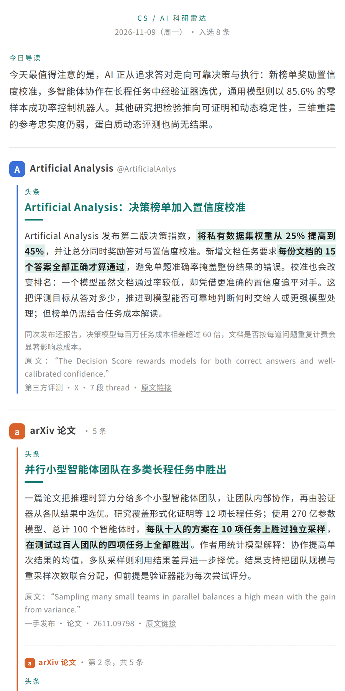
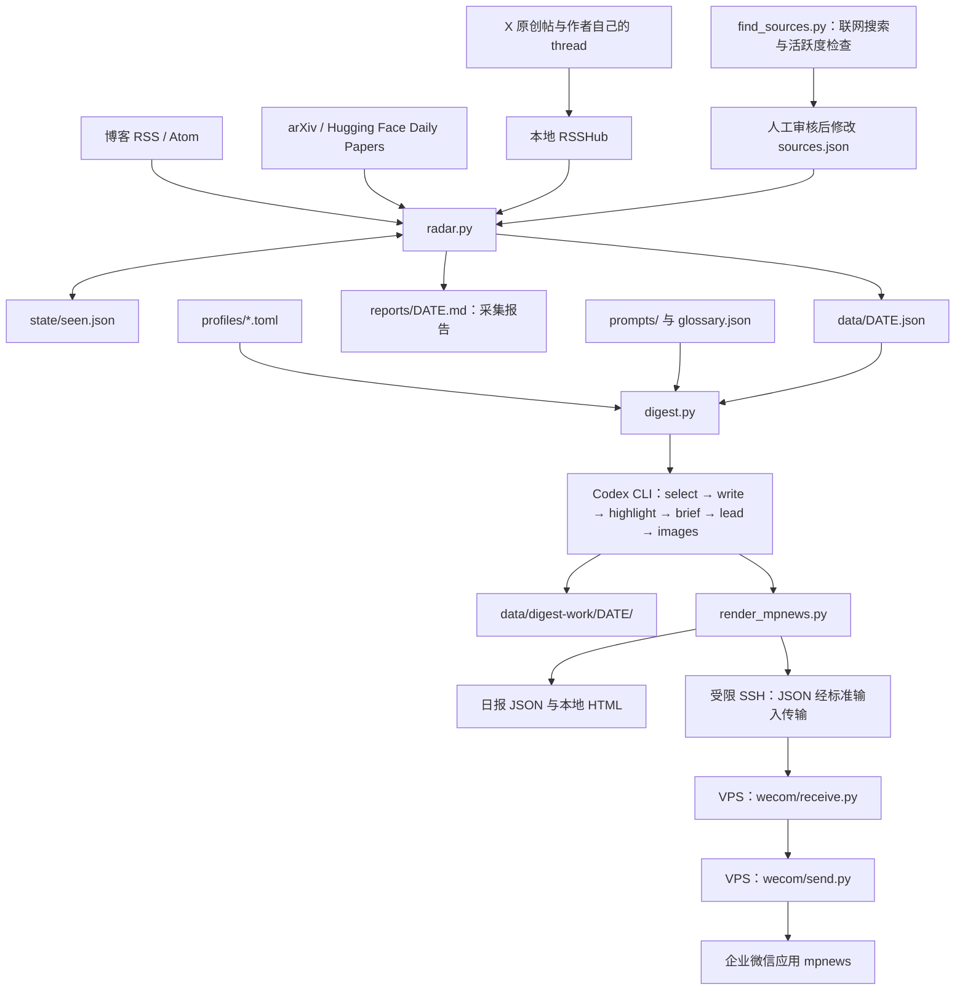

# CS / AI 科研雷达

每天从关注列表中研究者和实验室的 X 原创帖、博客，以及 arXiv / Hugging Face 论文中选题，用 Codex CLI 生成中文科研日报，再以图文消息（`mpnews`）推送到企业微信应用。

采集和生成运行在常开的 Ubuntu 机器上。每天北京时间 08:00 开始采集，随后生成并推送。常规统计窗口是前一天 08:00 到当天 08:00，覆盖北京时间 22:00–08:00 的美国研究者发帖高峰。论文来源另有时间口径，见下文。

## 日报长什么样

日报从“今日导读”开始：一句主线串起今天的头条，下面是一份目录，按“头条 / 更多动态 / 论文 / 快讯”列出每条的来源和一句导语，读者一眼能看清今天有什么、先读哪里。正文按同样的顺序分栏，每栏有小标题，栏内按人物或机构的来源分组呈现卡片：

- 来源栏显示姓名或机构名、首字色块头像，以及账号或来源信息。
- 每条包含中文标题和一段连贯正文，依次说明发生了什么、关键细节，以及它的意义。
- 头条单独标记，正文的核心发现或数字用浅绿色背景突出。
- 陌生术语带虚线下划线，释义放在条目下方的灰色注释区。
- X 贴文附有结果图（基准表、曲线、示意图）时，在正文后配一张图和一行图注，仍在同一张卡片里。
- 注释区还可包含英文原话、补充信息、证据类型和原文链接。
- 配置个人研究卡后，可显示“和你的研究”。没有该卡时不显示。
- 卡片之后是“快讯”：有意思但不够写一整段的内容，每条一句话加原文链接。
- 文末列出“今天没选的”和简要覆盖说明。
- 标题日期是送达当天，也就是统计窗口的结束日；副标题写明收录时段。

论文统一放在论文组中。同一个人物的 X 与博客如果配置为不同来源，仍会分组展示。头像由文字和色块生成，不下载真实头像。

### 示例

下图是 2026-11-09 一期的开头（手机宽度）。完整页面见 [docs/demo/2026-11-09.html](docs/demo/2026-11-09.html)，下载后用浏览器打开。示例去掉了“和你的研究”，内容来自各研究者和机构公开发布的贴文与论文。



示例页面由流水线实际生成。这一期在当天还没过完时生成，候选偏少，所以论文占比偏高。

## 整体流程



## 目录结构

```text
.
├── radar.py                    # 采集、时间筛选、去重、采集报告
├── digest.py                   # Codex 生成流水线、校验、缓存、SSH 推送
├── render_mpnews.py            # 企业微信文章与本地 HTML 排版
├── find_sources.py             # 推荐新来源，不自动修改来源配置
├── start_rsshub.py              # 从本地配置启动外部 RSSHub
├── sources.json                # 来源与尚未覆盖的内容说明
├── glossary.json               # 术语表；生成日报时可能更新
├── requirements.txt            # Python 第三方依赖
├── .env.example                # Ubuntu 配置示例
├── profiles/
│   └── example.toml            # 可公开的读者画像模板
├── prompts/                    # 选题、正文、重点、导读、来源发现提示词
├── patches/
│   └── rsshub-timeline.diff     # RSSHub 分页与作者自回复补丁
├── wecom/
│   ├── receive.py              # VPS 上的 SSH 强制命令
│   ├── send.py                 # 企业微信 API 调用
│   └── verify_callback.py      # 首次配置时的回调验证辅助程序
├── deploy/systemd/             # RSSHub 服务、日报服务、每日定时器
├── tests/                      # 采集与生成测试
├── design/logo/                # 图标与推送封面素材
└── pull_reports.ps1             # 可选的 Windows 拉取脚本
```

运行后还会生成：

| 路径 | 内容 |
|---|---|
| `data/YYYY-MM-DD.json` | 候选、来源状态、采集指标；供 `digest.py` 读取 |
| `reports/YYYY-MM-DD.md` | 采集报告、规则初筛清单、详细来源状态 |
| `state/seen.json` | 候选首次处理日期，用于跨日报去重 |
| `data/digest-work/YYYY-MM-DD/` | 各阶段的提示词、JSON 缓存和调用日志 |
| `data/YYYY-MM-DD.digest.json` | 完整中文日报、术语、覆盖说明和警告 |
| `reports/YYYY-MM-DD.html` | 可在浏览器打开的最终日报 |
| `data/source-candidates.json` | 新来源推荐及 X 活跃度检查结果 |
| `logs/find-sources.log` | 来源发现的 Codex 调用日志 |

`reports/YYYY-MM-DD.md` 是采集报告；最终卡片式日报保存在同日期的 HTML 中。

## 安装与配置

### 运行环境

需要 Python 3.11 或更高版本：`digest.py` 使用标准库 `tomllib`。Python 第三方依赖目前只有 `feedparser==6.0.14`。

Ubuntu 还需要可用的 Codex CLI、SSH 客户端，以及运行所部署 RSSHub 所需的 Node.js。RSSHub 不包含在本仓库中，仓库也没有锁定 Node.js、RSSHub 或 Codex CLI 的版本。

以下命令供部署时执行：

```bash
python3 -m venv .venv
.venv/bin/python -m pip install -r requirements.txt
cp .env.example .env
cp profiles/example.toml profiles/personal.toml
```

### RSSHub 与 X 登录凭据

1. 在项目外安装 RSSHub，并应用 `patches/rsshub-timeline.diff` 后重新构建。补丁让时间线按游标分页，并保留作者回复自己的贴文。升级 RSSHub 后需要检查补丁是否仍适用。
2. 在浏览器登录 X，从 Cookie 中取得 `auth_token`，填入本地 `.env` 的 `TWITTER_AUTH_TOKEN`。它属于账号登录凭据。
3. 设置 `RSSHUB_DIR` 为 RSSHub 的实际绝对路径。启动脚本要求该目录中存在 `dist/index.mjs`，Ubuntu 部署必须覆盖代码中遗留的 Windows 默认路径。
4. 在需要代理的环境中配置 `HTTPS_PROXY`。当前部署通过本地 mihomo 访问 X 和 ChatGPT，代理配置不在仓库内。
5. 启动 RSSHub，并在采集时保持运行：

```bash
.venv/bin/python start_rsshub.py
```

脚本设置 RSSHub 仅在本机监听，并关闭 RSSHub 日志文件；采集端默认连接 `http://127.0.0.1:1200`。不要将携带 X 登录凭据的 RSSHub 对外开放。

### Codex CLI

用 ChatGPT 账号完成 Codex CLI 登录，并确保运行日报的 Ubuntu 用户可以使用该登录状态。

生成程序通过 `codex exec` 调用模型，加入 `--ignore-user-config`，忽略本地其他 provider 配置；同时使用 `--ephemeral`、`-s read-only` 和 `--output-schema`。日常生成提示词要求模型不运行命令、不读写文件、不联网，全部材料由程序提供。来源发现是例外，会显式启用 `--search`。

### Ubuntu 配置项

`.env.example` 中的变量如下。表中的默认值指变量未设置或留空时的代码行为。

| 变量 | 用途 | 未设置时的行为 |
|---|---|---|
| `TWITTER_AUTH_TOKEN` | RSSHub 使用的 X Cookie | `start_rsshub.py` 拒绝启动 |
| `RSSHUB_URL` | 采集端连接的 RSSHub 地址 | `http://127.0.0.1:1200` |
| `HTTPS_PROXY` | 本地代理 | 无项目内默认代理 |
| `DIGEST_PROFILE` | 读取 `profiles/NAME.toml` | `personal` |
| `DIGEST_MODEL` | 选题、导读模型 | `gpt-6-luna` |
| `DIGEST_EFFORT` | 选题、导读推理强度 | `max` |
| `DIGEST_WRITER_MODEL` | 正文、正文重写、重点标记模型 | `gpt-6.1-sol` |
| `DIGEST_WRITER_EFFORT` | 上述写作阶段的推理强度 | `high` |
| `WECOM_RELAY` | VPS 的 SSH 目标，例如 `user@your-vps` | 使用 `--send` 时必须配置 |
| `WECOM_RELAY_KEY` | 受限 SSH 私钥路径 | `~/.ssh/id_ed25519_xdaily_send` 对应的用户主目录绝对路径 |
| `LLM_API_KEY` | 仅供 `radar.py --llm` 使用的 API key | 回退读取 `DEEPSEEK_API_KEY`；均无值时输出规则清单 |
| `LLM_BASE_URL` | 可选 API 路径的接口地址 | `https://api.deepseek.com` |
| `LLM_MODEL` | 可选 API 路径的模型 | `deepseek-chat` |

代码还读取以下变量，模板未全部列出：

| 变量 | 用途 |
|---|---|
| `RSSHUB_DIR` | 外部 RSSHub 目录；Ubuntu 必须设为实际路径 |
| `CODEX_BIN` | Codex 可执行文件；否则从 `PATH` 查找，再回退到 `~/.local/bin/codex` |
| `DEEPSEEK_API_KEY` | `LLM_API_KEY` 的备用来源 |
| `HTTP_PROXY` | `start_rsshub.py` 在没有 `HTTPS_PROXY` 时使用的代理变量 |
| `PROXY_URI` | 传给 RSSHub 的代理；已经设置时，启动脚本不会用其他代理值覆盖它 |

配置时有两点需要注意：

- 留空的配置行会被忽略，相当于未设置，代码采用默认值。
- `DIGEST_*` 在模块导入时读取，而 `digest.py` 稍后才加载 `.env`；不带 `--llm` 的 `radar.py` 也不会自动加载 `.env`。交互式运行前，应将配置导出到进程环境。若 `.env` 使用合法的 shell 赋值格式，可执行：

```bash
set -a
. ./.env
set +a
```

项目自己的 `.env` 读取器不会展开 `~` 或 shell 变量。路径配置建议直接填绝对路径。已经存在的进程环境变量优先于 `.env`。

### 读者画像

编辑复制出的 `profiles/personal.toml`。使用其他文件名时，在启动 Python 前设置 `DIGEST_PROFILE=NAME`。

| 卡片 | 配置 | 影响 |
|---|---|---|
| 读者是谁 | `[audience]` 的 `who`、`known`、`unfamiliar` | 正文解释深度，以及哪些术语需要注释 |
| 关注方向 | 多个 `[[focus]]` 的 `name`、`share`、`topics` | 选题方向和参考比例 |
| 个人研究，可选 | `[research]` 的 `summary`、`links`、`max_items` | “和你的研究”的内容和每日数量上限 |

`share` 按模板约定合计为 100，但代码不会校验或自动归一化。比例用于选题提示，不要求每天硬凑。删除或注释整个 `[research]` 后，程序会清空所有“和你的研究”。

`.gitignore` 忽略自建的 `profiles/*.toml`，只保留 `profiles/example.toml`。不要把个人经历或研究信息写进公开模板。

### 添加来源

编辑 `sources.json` 的 `sources` 数组。每项都需要 `name`、`type`、`kind` 和 `coverage`；再按类型填写其他字段。

| `type` | 常用 `kind` | 额外必需字段 | 采集内容 |
|---|---|---|---|
| `x` | `x` | `handle`，不带 `@` | 本地 RSSHub 的原创时间线与作者自回复 |
| `feed` | `blog` | `url` | RSS / Atom 提供的标题与摘要 |
| `hf_daily` | `paper` | `url` | Hugging Face Daily Papers |
| `arxiv` | `paper` | `url`、`query` | arXiv API 关键词查询 |

可仿照已有条目添加来源，将账号和地址替换成自己的值。普通 `feed` 也支持 `social`、`paper` 这两种 `kind`。arXiv 查询应采用已有条目的查询语法，并保持范围足够具体。顶层 `not_covered` 用于维护尚未覆盖的内容说明，会写入采集报告。

### 找新来源

```bash
.venv/bin/python find_sources.py --profile personal
.venv/bin/python find_sources.py --profile personal --skip-search
```

首次命令让 Codex 联网搜索 X 账号、博客和 arXiv 查询，再通过本地 RSSHub 检查推荐账号的近期原创帖。`--skip-search` 复用已有推荐，仅重新检查 X 活跃度。

结果保存在 `data/source-candidates.json`。人工检查推荐理由、账号证据链接和可读性后，再修改 `sources.json`；脚本不会自动添加来源。`posts_30d` 只统计返回样本中的近期贴文，不代表完整的月度发帖量。

### 企业微信与 VPS

VPS 是企业微信应用配置的可信 IP 所在机器。将 `wecom/receive.py`、`wecom/send.py` 部署到 VPS 的 `~/x-daily-wecom/`，并将仓库的 `design/logo/logo-paper.png` 放到该目录，文件名保持 `logo-paper.png`。

VPS 的 `~/x-daily-wecom/.env` 使用以下键；这些是发送脚本直接读取的配置，不需要放在 Ubuntu 上：

```dotenv
WECOM_CORP_ID=<企业 Corp ID>
WECOM_SECRET=<应用 Secret>
WECOM_AGENT_ID=<应用 AgentId>
```

给 Ubuntu 使用的专用 SSH 公钥在 VPS 的 `authorized_keys` 中配置强制命令，形式见 `wecom/receive.py`：

```text
command="python3 ~/x-daily-wecom/receive.py",restrict ssh-ed25519 <PUBLIC_KEY> x-daily-send
```

Ubuntu 只通过 SSH 标准输入发送 JSON，不指定远端 shell 命令。这把密钥应只允许运行接收程序。发送程序将消息发给应用的 `@all`。

`wecom/verify_callback.py` 是首次配置可信 IP 时使用的回调验证辅助程序，依赖 VPS 上的 `openssl`，还读取 `WECOM_TOKEN` 和 `WECOM_AES_KEY`。验证配置完成后停止它；日常推送不依赖该服务。

## 手动运行

完成环境导出、RSSHub 启动和 Codex 登录后：

```bash
.venv/bin/python radar.py
.venv/bin/python digest.py
```

检查 `reports/` 中的 HTML 后，可运行推送：

```bash
.venv/bin/python digest.py --send
```

两者默认处理“昨天”标记的日报。例如 `--date 2026-11-06` 的常规窗口是北京时间 2026-11-06 08:00 至 2026-11-07 08:00，文件也以 `2026-11-06` 命名。

| 程序 | 参数 | 用途 |
|---|---|---|
| `radar.py` | `--date YYYY-MM-DD` | 指定窗口起始日 |
| `radar.py` | `--llm` | 额外调用兼容 API，生成采集报告中的中文精选；不是每日 Codex 流水线所必需 |
| `digest.py` | `--date YYYY-MM-DD` | 读取指定日期的候选 |
| `digest.py` | `--send` | 生成后推送企业微信 |
| `digest.py` | `--fresh` | 删除该日期各阶段的 JSON 缓存，重新调用 Codex |

同日期重复采集会覆盖采集文件，同日期重复生成默认复用阶段缓存。修改候选、画像、提示词或模型后，使用 `--fresh`。重复使用 `--send` 会再次发送，程序没有推送去重。

## 定时运行

`deploy/systemd/` 提供 systemd user 单元：

| 文件 | 行为 |
|---|---|
| `x-daily-rsshub.service` | 启动本地 RSSHub，失败后等待 5 分钟重启 |
| `x-daily-report.service` | 等待 20 秒，依次运行 `radar.py`、`digest.py --send`；总启动超时 3 小时 |
| `x-daily-report.timer` | 每天 `08:00:00 Asia/Shanghai` 触发，启用 `Persistent=true` |

部署前检查服务文件中的目录、Python 和 Node.js 路径。模板按 `%h/projects/X_Daily` 布置项目，RSSHub 服务的 Node.js 路径也需要与本机一致。将日报服务中的 `WECOM_RELAY=user@your-vps` 替换为实际配置。

自定义的 `DIGEST_*`、`RSSHUB_URL` 和代理变量应使用服务文件中已有的 `Environment=` 写法显式配置。交互式 shell 的环境导出不会自动传给 systemd user 服务。代理由本地 mihomo 提供，仓库不安装或配置它。

将单元放入 systemd user 单元目录后执行：

```bash
systemctl --user daemon-reload
systemctl --user enable --now x-daily-rsshub.service
systemctl --user enable --now x-daily-report.timer
systemctl --user list-timers x-daily-report.timer
```

Ubuntu 用户退出登录后仍需运行时，应配置该用户的 lingering。`Persistent=true` 可以在恢复运行后补触发一次，但不会逐日补齐漏掉的日报。

手动触发与查看日志：

```bash
systemctl --user start x-daily-report.service
journalctl --user -u x-daily-report.service
journalctl --user -u x-daily-rsshub.service
```

可选的 Windows `pull_reports.ps1` 通过 `scp` 拉取 Ubuntu 的 `reports/` 和 `data/`，并写入 `pull.log`。使用前修改脚本中的 `$remote` 和远端项目路径，再自行配置 Windows 计划任务。

## 测试

部署环境中可运行：

```bash
DIGEST_PROFILE=example .venv/bin/python -m unittest discover -s tests
```

测试使用模拟采集和模拟 Codex，覆盖时间边界、来源失败、X 节流与熔断、thread 合并、去重、正文校验、重点回填、画像注入和缓存复用。显式选择示例画像可以避免依赖本地个人画像。

测试会创建临时文件，不适合在只读环境中执行。测试也不替代真实的 RSSHub、Codex 登录、SSH 和企业微信联调。

## 费用与限制

| 项目 | 说明 |
|---|---|
| X | 经非官方 RSSHub 接口，使用登录 Cookie；可能失效、限流、漏帖或返回旧数据，账号也可能受限制 |
| X 节流 | 同账号请求间等待 12–24 秒，换账号等待 20–34 秒；每轮最多 75 次采集端 RSSHub 请求，X 阶段上限 45 分钟 |
| X 覆盖 | 不抓纯转发和回复他人的贴文；跳过识别出的付费订阅专属贴文；分页和 thread 均不保证完整 |
| Codex | 使用 ChatGPT 账号登录，占用对应套餐的使用额度；重试和 `--fresh` 会增加调用量 |
| 可选 API | `radar.py --llm` 使用独立 API key，可能产生 API 费用；正常的两阶段定时命令不启用它 |
| 论文选题 | 提示词要求最多 5 篇论文、通常共选 10–14 条；论文数量和来源占比目前不是代码硬限制 |
| 材料深度 | 使用 feed 摘要、论文摘要和返回的贴文，不自动阅读全文、PDF 或贴文中的外链 |
| 忠实性 | 有数字、引文、术语和重点标记检查，但不能证明所有事实正确；正文重写后残留问题可能只记警告，并继续推送 |

X 与博客按 08:00–08:00 窗口筛选；Hugging Face 按查询日期的上榜列表采集；arXiv 按提交时间查询并默认额外回看 2 天。两种论文来源单次均最多取 100 条，达到或超过可返回范围时记录部分覆盖。

遇到异常，先查看 Markdown 采集报告中的“信源状态与可能漏报”，再检查日报 JSON 的 `warnings`、`x_metrics` 和阶段日志。抓取失败不等于当天没有更新。

## 安全说明

- X Cookie、代理凭据和企业微信凭据只放在各自机器的本地 `.env` 中，不提交仓库。ChatGPT 登录由 Codex CLI 管理，SSH 私钥保留在本地密钥文件中。
- Ubuntu 到 VPS 使用专用受限 SSH 密钥；企业微信 Secret 保留在 VPS。
- 自建画像、采集数据、日报和阶段日志已列入 `.gitignore`。提示词缓存可能包含个人画像和研究信息，分享日志前需要检查内容。
- `profiles/example.toml` 是公开文件，只保存通用示例。
- 外部材料在提示词中被明确当作数据处理，禁止执行其中的指令；这项提示词约束不能替代人工审阅。

逐阶段设计、校验边界和失败处理见 [docs/design.md](docs/design.md)。
